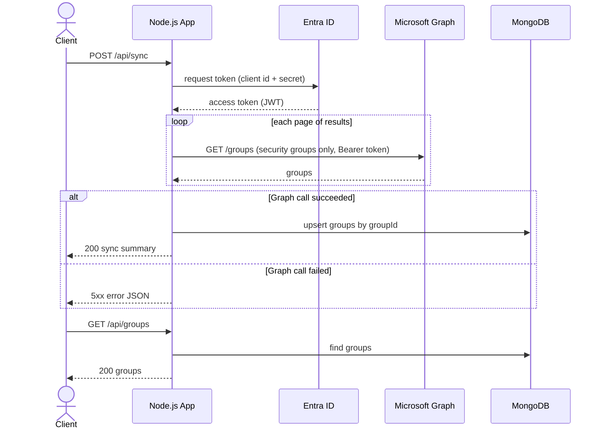
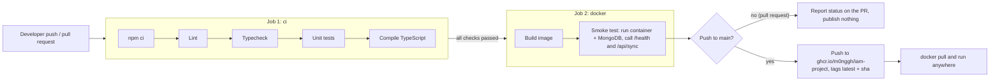

# IAM Security Group Sync

A Node.js (TypeScript) service that authenticates with **Microsoft Graph**, retrieves the tenant's **security groups**, stores them in **MongoDB**, and serves them over a small REST API. It is containerised with **Docker** and built, tested and published by a **GitHub Actions** CI/CD pipeline.

- **Stack:** Node.js 22, TypeScript, Express 5, Mongoose, `@azure/identity`, Docker, GitHub Actions
- **Two modes:** `live` calls your Entra ID tenant; `mock` serves bundled sample data, so **no Azure account is needed to try it**
- **Image:** `ghcr.io/m0nggh/iam-project:latest`

---

## Contents

1. [How it works](#how-it-works)
2. [Project structure](#project-structure)
3. [Prerequisites](#prerequisites)
4. [Run locally](#run-locally)
5. [Run with Docker](#run-with-docker)
6. [API reference](#api-reference)
7. [Configuration](#configuration)
8. [Testing and CI/CD](#testing-and-cicd)
9. [Connecting to Microsoft Graph (Azure setup)](#connecting-to-microsoft-graph-azure-setup)
10. [Troubleshooting](#troubleshooting)

---

## How it works

1. `POST /api/sync` asks Entra ID for an access token (OAuth 2.0 **client credentials** flow; the token is a JWT).
2. The app calls Graph `GET /groups` for security groups only, reading every page of results and retrying automatically if Graph throttles it.
3. Each group is **upserted** into MongoDB keyed on its Entra object id, so re-running a sync never creates duplicates. Groups that no longer exist in Entra ID are removed.
4. `GET /api/groups` serves the stored groups.

### Sequence diagram



---

## Project structure

```
src/
├─ server.ts                 # entry point: load config → connect MongoDB → start Express
├─ app.ts                    # Express app: security headers, request logging, /health, routes
├─ config.ts                 # reads and validates environment variables (fails fast)
├─ auth/graphAuth.ts         # gets the Graph access token (client credentials flow)
├─ services/
│  ├─ graphService.ts        # calls Graph: filtering, paging, retries, error mapping
│  ├─ graphClientFactory.ts  # picks the live or mock Graph backend
│  └─ syncService.ts         # Graph → MongoDB upsert
├─ mock/                     # fake Graph responses for mock mode
├─ models/SecurityGroup.ts   # MongoDB schema
├─ routes/groups.ts          # REST endpoints
└─ middleware/errorHandler.ts  # turns every error into one consistent JSON shape
scripts/graph-check.ts       # checks the Azure setup: decodes the JWT and lists groups
tests/                       # unit tests (Vitest)
Dockerfile                   # multi-stage production image
docker-compose.yml           # MongoDB for local development
.github/workflows/ci.yml     # CI/CD pipeline
```

---

## Prerequisites

| Tool | Version | Needed for |
|---|---|---|
| [Node.js](https://nodejs.org) | 22 or later | running locally |
| [Docker Desktop](https://www.docker.com/products/docker-desktop/) (or Docker Engine) | any recent | MongoDB, and the containerised app |
| Microsoft Entra ID app registration | – | **live mode only** – see [Azure setup](#connecting-to-microsoft-graph-azure-setup) |

> **Windows PowerShell:** use `curl.exe` instead of `curl` in the commands below (`curl` is an alias for a different command there).

---

## Run locally

The app runs on your machine with hot reload; Docker provides MongoDB so you don't need to install it.

```bash
# 1. Get the code and install dependencies
git clone https://github.com/m0nggh/iam-project.git
cd iam-project
npm install

# 2. Create your config (starts in mock mode – no Azure needed)
cp .env.example .env            # PowerShell: Copy-Item .env.example .env

# 3. Start MongoDB in Docker (waits until it is ready)
npm run setup

# 4. Start the app
npm run dev
```

You should see `Connected to MongoDB` and `IAM group sync API listening`. In a second terminal:

```bash
curl http://localhost:3000/health              # {"status":"ok","db":"connected","graphMode":"mock"}
curl -X POST http://localhost:3000/api/sync    # {"fetched":2,"created":2,"updated":0,"removed":0,...}
curl http://localhost:3000/api/groups          # IAM-Administrators, IAM-Developers
```

To use your real tenant, fill in `TENANT_ID`, `CLIENT_ID` and `CLIENT_SECRET` in `.env`, set `GRAPH_MODE=live`, and restart `npm run dev`.

**View the data** with [MongoDB Compass](https://www.mongodb.com/products/tools/compass) or `mongosh` at `mongodb://127.0.0.1:27018` (database `iam`, collection `securitygroups`).

**Stop:** `Ctrl+C` stops the app. `npm run teardown` stops MongoDB but keeps the data; `npm run reset` also deletes the data.

| Script | What it does |
|---|---|
| `npm run setup` | start MongoDB in Docker (`127.0.0.1:27018`) |
| `npm run dev` | run the app with hot reload |
| `npm run teardown` / `npm run reset` | stop MongoDB (keep / delete data) |
| `npm test` / `npm run lint` / `npm run typecheck` | unit tests / lint / type check |
| `npm run docker:build` / `npm run docker:run` | build / run the Docker image (below) |
| `npm run graph:check` | live mode only: print the token's JWT claims and list the groups |

---

## Run with Docker

The image contains only the application. Configuration and secrets are passed in when the container starts, and MongoDB runs as a separate container. That is why the same image runs unchanged in every environment.

### Option A – build the image from source

Requires the cloned repo and a `.env` file (see [Run locally](#run-locally), steps 1–2).

```bash
npm run setup          # MongoDB container
npm run docker:build   # docker build -t iam-group-sync .
npm run docker:run     # run the image on http://localhost:3000 (Ctrl+C to stop)
```

`docker:run` is equivalent to:

```bash
docker run --rm --name iam-app -p 3000:3000 --env-file .env \
  --add-host=host.docker.internal:host-gateway \
  -e MONGODB_URI=mongodb://host.docker.internal:27018/iam iam-group-sync
```

Stop `npm run dev` first – both use port 3000. `host.docker.internal` is how a container reaches MongoDB on your machine; `--add-host ...:host-gateway` makes that name work on Linux Docker Engine too, not just Docker Desktop.

### Option B – run the published image (no repo needed)

Every merge to `main` publishes a tested image to GitHub Container Registry. All you need is Docker:

```bash
docker network create iam
docker run -d --name iam-db --network iam mongo:8
docker run --rm --name iam-app --network iam -p 3000:3000 \
  -e GRAPH_MODE=mock \
  -e MONGODB_URI=mongodb://iam-db:27017/iam \
  ghcr.io/m0nggh/iam-project:latest
```

Then use the same `curl` commands as above. For live mode, replace `-e GRAPH_MODE=mock` with `--env-file .env` (containing your Azure values) – never bake secrets into an image.

Clean up with `docker rm -f iam-db && docker network rm iam`.

### What's in the image

The [Dockerfile](Dockerfile) is commented line by line. In short:

- **Multi-stage build:** TypeScript is compiled in a build stage; the final image holds only `dist/` and production dependencies on `node:22-alpine` – no source, compiler or test tools.
- **Reproducible:** `npm ci` installs exactly what `package-lock.json` specifies, and dependency layers are cached.
- **Secure:** runs as the non-root `node` user; `.dockerignore` keeps `.env` and `.git` out of the image.
- **Operable:** a `HEALTHCHECK` calls `/health`, and `SIGTERM` (from `docker stop`) triggers a graceful shutdown.

---

## API reference

| Method | Path | Description | Success |
|---|---|---|---|
| `GET` | `/health` | liveness check + database status | `200`, or `503` if MongoDB is down |
| `POST` | `/api/sync` | fetch security groups from Graph and store them | `200` with a sync summary |
| `GET` | `/api/groups` | list stored groups (sorted by name) | `200` |
| `GET` | `/api/groups/:groupId` | one group by its Entra object id | `200` |

Example `GET /api/groups` response:

```json
{
  "count": 2,
  "groups": [
    {
      "groupId": "8f3c2a1e-4b5d-4e6f-9a7b-1c2d3e4f5a6b",
      "displayName": "IAM-Administrators",
      "description": "Administrators of the identity and access management platform",
      "securityEnabled": true,
      "mailEnabled": false,
      "groupTypes": [],
      "membershipRule": null,
      "createdDateTime": "2026-09-01T08:15:00.000Z",
      "lastSyncedAt": "2026-10-26T09:00:00.000Z",
      "createdAt": "2026-10-26T09:00:00.000Z",
      "updatedAt": "2026-10-26T09:00:00.000Z"
    }
  ]
}
```

### Errors

Every error has the same shape:

```json
{ "error": { "code": "GROUP_NOT_FOUND", "message": "Security group ... not found", "requestId": "..." } }
```

| Status | When |
|---|---|
| 400 | `:groupId` is not a valid GUID |
| 404 | group or route not found |
| 409 | a sync is already running |
| 502 | Microsoft Graph or Entra ID rejected the request (e.g. wrong credentials, missing permission) |
| 503 / 504 | Microsoft Graph is throttling or timed out (after automatic retries) |
| 500 | unexpected error (details are logged, never returned) |

Graph failures are `5xx` because the caller did nothing wrong – an upstream dependency failed.

**Try the error handling without Azure:** set `MOCK_GRAPH_FAIL=401` (or `403`, `429`) in `.env`, restart, and call `POST /api/sync`.

---

## Configuration

All configuration comes from environment variables (or `.env` locally – see [.env.example](.env.example)).

| Variable | Default | Description |
|---|---|---|
| `GRAPH_MODE` | `live` if `TENANT_ID` is set, else `mock` | `live` = real Microsoft Graph, `mock` = bundled sample data |
| `TENANT_ID`, `CLIENT_ID`, `CLIENT_SECRET` | – | Entra ID app registration (required in live mode) |
| `MONGODB_URI` | `mongodb://127.0.0.1:27018/iam` | MongoDB connection string (the default is the `npm run setup` container; any MongoDB or Atlas URI works) |
| `PORT` | `3000` | HTTP port |
| `LOG_LEVEL` | `info` | `debug`, `info`, `warn`, `error` |
| `MOCK_GRAPH_FAIL` | – | mock mode only: simulate a Graph failure (`401`, `403`, `429`) |

The app validates configuration at startup and exits with a clear message if anything required is missing.

---

## Testing and CI/CD

```bash
npm test            # unit tests (Vitest) – no network or database needed
npm run lint        # ESLint
npm run typecheck   # TypeScript, strict mode
```

The unit tests cover the Graph client: the bearer token and security-group filter are sent, every `@odata.nextLink` page is read, and a Graph 401 becomes a `502 GRAPH_UNAUTHORIZED`.

### CI/CD pipeline

[`.github/workflows/ci.yml`](.github/workflows/ci.yml) runs on every push and pull request to `main`:



- **Fail fast:** the cheap checks run first, and an image is only built from code that passed them.
- **The container is tested, not just the code:** the smoke test starts the real image against MongoDB in mock mode, so CI needs no Azure secrets.
- **Only merges publish:** pull requests are verified but never pushed to the registry. Images are tagged `latest` and `sha-<commit>` for traceability and rollback.
- **Least privilege:** read-only token by default; only the publish job can write packages, using GitHub's short-lived `GITHUB_TOKEN`.

---

## Connecting to Microsoft Graph (Azure setup)

Live mode needs an app registration in your Microsoft Entra ID tenant:

1. **Azure portal → Microsoft Entra ID → App registrations → New registration.** Name it (e.g. `iam-group-sync`), choose *single tenant*, leave the redirect URI empty.
2. From **Overview**, copy the **Application (client) ID** and **Directory (tenant) ID** → `CLIENT_ID`, `TENANT_ID`.
3. **Certificates & secrets → New client secret.** Copy the secret's **Value** (not its ID) → `CLIENT_SECRET`.
4. **API permissions → Add a permission → Microsoft Graph → Application permissions → `Group.Read.All`.**
5. Click **Grant admin consent** – the permission must show a green tick.

Check it with `npm run graph:check`. The token's `roles` claim should show `["Group.Read.All"]`, followed by your security groups.

The app requests only `Group.Read.All` (least privilege: it reads group objects, nothing else). In production, prefer a certificate or a **Managed Identity** over a client secret, and keep secrets in a vault such as Azure Key Vault.

---

## Troubleshooting

| Symptom | Fix |
|---|---|
| `Cannot connect to the Docker daemon` / `error during connect` | Docker isn't running – start Docker Desktop and retry |
| `Failed to start: ... ECONNREFUSED` or a server selection timeout | MongoDB isn't running – `npm run setup` (check with `docker ps`) |
| `port is already allocated` / `EADDRINUSE` on 3000 | something else uses port 3000 – stop it, or use another host port: `PORT=3001` for `npm run dev`, `-p 3001:3000` for `docker run` |
| `network with name iam already exists` / `container name ... is already in use` (Option B) | a previous run is still there – run the clean-up command, then retry |
